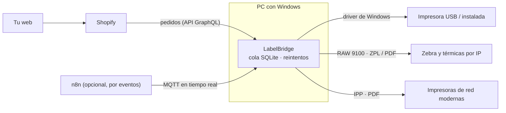
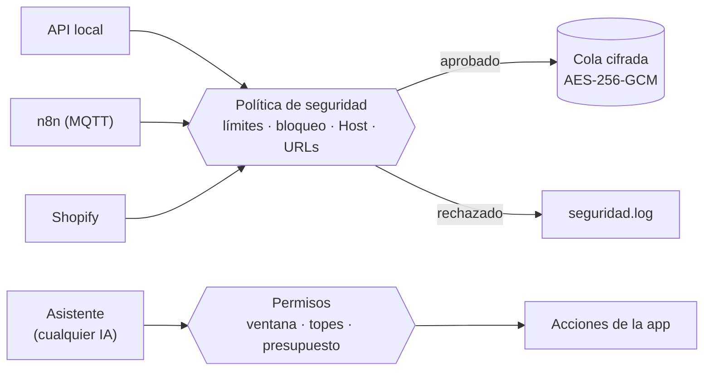

# LabelBridge

App de escritorio para **Windows** y **Mac** (Apple Silicon) que imprime automáticamente las etiquetas de tus pedidos de **Shopify**. Se instala una vez, arranca sola con el equipo, vive en la bandeja del sistema (en la Mac, en la barra de menús) e imprime en segundo plano en cualquier impresora: instalada en el sistema o conectada por **Wi‑Fi / red local** (sin driver).



## Qué hace

- **En español o en inglés**: el instalador, con la marca, deja elegir **English / Español** y la app entera queda en ese idioma (pantallas, guía con sus capturas, etiqueta de prueba, notas de actualización y el asistente). Se cambia en **Ajustes → General → Idioma / Language**. La primera vez, el instalador también pregunta la tienda de Shopify (dirección y Client ID) para adelantar; la clave secreta se pide después en la app, en su ventana segura.
- **Pedidos, ordenados**: pestaña con todos los pedidos de Shopify. Primero los que necesitan acción, con el porqué y el botón para resolverlo (comprar a mano la guía de FedEx, reimprimir, reintentar una compra rechazada…). Después, por paquetería, con seguimiento, valor de las piezas, costo de cada guía (también las compradas a mano y las anuladas), resumen de gasto y exportación a CSV. Las **reglas de paquetería** deciden por cuál sale cada pedido (por defecto, piezas de más de US$1000 → FedEx: se compra en Shopify con un clic, porque Shopify no deja comprarla por API, y LabelBridge la imprime sola; el resto → USPS, comprada e impresa automáticamente).
- **Imprimir guía**: en **Pedidos**, eliges un pedido y pulsas **Imprimir guía**: si ya tiene guía se reimprime; si no, una ventana corta deja elegir el **servicio** (USPS, UPS, DHL Express o **Automático**: lo que elija Shopify), la caja (paquete de Shopify, **Mi caja** u otra), el peso y el aviso al cliente, y con un clic se compra con Shopify Shipping, se imprime y Shopify queda al día con el seguimiento. FedEx sale en la lista para comprarla en Shopify (LabelBridge la imprime sola al verla). Si Shopify no ofrece el servicio para ese envío, no cobra nada. Con `read_shipping` la lista muestra solo lo que Shopify ofrece para ese envío (`connectors/shipping_services.py`, `ui/purchase_dialog.py`).
- **Varios pedidos a la vez**: con varios elegidos, **Imprimir N guías** reimprime los que ya tienen guía y compra los demás con una sola confirmación, de uno en uno, con el resultado y el total gastado; omite con el porqué los que no llevan guía o se compran en Shopify (hasta 25 compras por tanda; `connectors/label_batch.py`, `ui/bulk_print_dialog.py`).
- **Ver pedido**: doble clic en un pedido muestra qué tiene sin salir de la app (productos con foto, variante, SKU y personalización, dirección, método, totales, nota del cliente, mensaje de regalo y seguimiento) y sus **instrucciones** (empaque, regalo, firma…), que se guardan en la nota del pedido en Shopify sin tocar la del cliente. Con `read_customers` dice si el cliente ya compró antes (y su email si Shopify aprobó ese dato); los datos protegidos que la app no tiene aprobados llegan vacíos sin romper nada (`connectors/shopify_orders.py`, `ui/order_dialog.py`).
- **Guía manual**: **Nueva guía manual** en Pedidos crea en Shopify un pedido marcado `LabelBridge-manual` (pagado, sin cobrar al cliente, con productos de la tienda o un artículo libre) y abre **Imprimir guía** para ese pedido. La compra automática no toca esos pedidos (`ui/manual_label_dialog.py`).
- **Avisos por email** a los dueños por SMTP (Gmail, iCloud, Yahoo u otro, con contraseña de aplicación): cada aviso se puede mandar también por email, con tope por hora y solo a las direcciones de Ajustes (`connectors/email.py`).
- **Avisos y sonidos**: pedido nuevo (caja registradora), pedido que necesita acción, retrasos de entrega, guía impresa y errores, cada uno con su aviso y su sonido (tonos propios generados por la app, el de Windows o un .wav), volumen, horario de silencio y recordatorio (`system/sounds.py`, `ui/alerts.py`).
- **Alertas de entrega**: **Retrasos y entregas** en Pedidos con lo que informa la paquetería a Shopify: entrega atrasada, intento fallido, problemas, paquete que la paquetería no recibe y demasiado tiempo en camino. Se revisa cada media hora y cada alerta avisa una vez.
- **Asistente flotante con la máscara viva**: un botón dorado con la máscara del logo, abajo a la derecha de todas las pantallas (o la pestaña **Asistente**, o **F1**), abre el chat sin salir de lo que estás haciendo. Es el logo original tal cual (`assets/mascot/`, generado desde `assets/brand-logo.png` con `packaging/make_mascot_assets.py`) y se anima encima: parpadea, te sigue con la mirada y cambia de expresión según la conversación: escucha mientras escribes, piensa (la corona carga en índigo), trabaja, responde, se alegra cuando algo queda listo, pregunta, se preocupa ante un error y se duerme si no se usa. Respeta la opción de Windows de reducir las animaciones. Diseño: «Asistente LabelBridge: máscara animada» en Claude Design.
- **Asistente con IA (la que prefieras)**: escribes tus datos con tus palabras («tengo una Zebra por USB y mi tienda es mi-tienda.myshopify.com») y el asistente configura la app con las mismas acciones de las pantallas: agrega la impresora, conecta la tienda, prueba la conexión y activa la impresión de las guías. Funciona con **Claude (Anthropic), OpenAI (ChatGPT), Google Gemini, OpenRouter, DeepSeek, Groq, xAI, Mistral, Together, modelos en tu equipo con Ollama o LM Studio, o cualquier API compatible con OpenAI**, cada uno con tu propia clave. Los permisos, límites y filtros son los mismos con cualquier modelo. Los secretos se piden en una ventana segura y nunca se envían al modelo; comprar guías siempre pide confirmación.
  Con los pedidos: busca y lee pedidos, escribe sus instrucciones y avisa a los dueños por email sin pedir permiso (con tope y auditoría), y crea pedidos manuales o compra guías siempre con confirmación (`assistant/order_tools.py`). Sigue las **reglas del dueño** de Ajustes → Asistente, que no pueden saltarse confirmaciones ni límites.
- **Guía paso a paso integrada**: al instalar, la app abre una guía que lleva de la mano por toda la configuración (impresora, prueba, remitente, app de Shopify, pedido de prueba) y marca cada paso solo cuando comprueba que quedó listo.
- **Impresoras**: lista las instaladas en Windows y **busca en la red** (puertos 9100/631/515 y Bonjour) automáticamente cada vez que el PC se conecta a una red Wi‑Fi/LAN, avisando si aparece una impresora nueva. Imprime por driver, por **IP directa sin driver** (RAW 9100 o IPP) y puede **instalar en Windows** una impresora de red encontrada.
- **Formatos**: PDF, PNG/JPG, **ZPL**, RAW (EPL/TSPL/ESC‑POS). Convierte PDF a ZPL para cualquier Zebra, **rota** etiquetas apaisadas y **recorta** una 4×6 dentro de una hoja carta/A4.
- **Shopify directo** (sin n8n):
  - **guía de envío de Shopify Shipping** (la etiqueta principal): la compra por API (`shippingLabelPurchase`, nueva en 2026‑07) para cada pedido pagado y la imprime en PDF/ZPL, con límite diario y sin compras duplicadas. Sale siempre a **4 × 6 in reales** en cualquier papel (llena un rollo 4×6; en carta o A4 va arriba y centrada), configurable en *Tamaño*;
  - etiqueta interna de pedido opcional (dirección, productos, código de barras Code 128 y QR al pedido, sin franqueo);
  - impresión de la URL guardada en un **metafield** del pedido (etiquetas de cualquier paquetería creadas por n8n o tu web).
- **n8n por eventos**: n8n se ejecuta **solo cuando ocurre algo** (pedido pagado) y envía la etiqueta al PC al instante por un canal MQTT cifrado. Si el PC está apagado, la etiqueta espera y se imprime al encenderlo. 1 ejecución por pedido, sin consultas periódicas.
- **API local** HTTP con clave, para n8n en tu red, tu web, scripts o un ERP.
- **Cola persistente** (SQLite): nada se pierde si se va la luz; reintentos automáticos; historial con vista previa, reimpresión y cancelación.
- **Profesional por dentro**: secretos en el Administrador de credenciales de Windows (Llavero en la Mac), una sola instancia, inicio con el equipo, notificaciones, registro en vivo, instalador con Inno Setup (`.dmg` en la Mac).

## Por qué Python + PySide6 (Qt)

- **Qt** da en un solo framework la interfaz nativa, la bandeja del sistema, la lista de impresoras, el render de PDF (PDFium) y la impresión por driver.
- Puedes **desarrollar y probar en tu Mac** (impresoras de prueba que guardan PDF/ZPL) y generar el `.exe` para Windows con GitHub Actions.
- El resultado es un `.exe` normal con instalador, sin que el usuario instale Python.

La alternativa sería C#/.NET (WPF): igual de válida en Windows, pero no podrías ejecutarla ni probarla en tu Mac.

## Empezar (desarrollo)

Requisitos: Python 3.11–3.13 (recomendado 3.12).

```bash
python3.12 -m venv .venv
```

```bash
.venv/bin/pip install -r requirements.txt -r requirements-dev.txt
```

```bash
.venv/bin/python run.py --show
```

En Windows usa `.venv\Scripts\python run.py --show`.

Primeros pasos dentro de la app:

1. **Impresoras → Agregar → Guardar como archivo (pruebas)** para probar sin gastar etiquetas (guarda PDF/ZPL en la carpeta «salida»).
2. Agrega tu impresora real: *Instaladas en este equipo* o *En la red → Buscar en la red*. Pulsa **Imprimir prueba**.
3. **Shopify**: sigue [docs/SHOPIFY.md](docs/SHOPIFY.md) para crear la app en el Dev Dashboard, pega Client ID y Client secret y **Guardar y probar conexión**.
4. Elige qué imprimir en cada pedido y la impresora de cada cosa.

Pruebas automáticas (no usan impresoras reales):

```bash
QT_QPA_PLATFORM=offscreen .venv/bin/python -m pytest -q
```

## Generar el instalador de Windows

**Opción A — GitHub Actions (no necesitas Windows):** sube el proyecto a un repositorio de GitHub y crea un tag `v1.0.0`, o ejecuta el workflow *Build installers* a mano. Descarga `LabelBridge-Setup-1.0.0.exe` desde los *artifacts* de la ejecución.

**Opción B — En un PC con Windows:**

```powershell
powershell -ExecutionPolicy Bypass -File packaging\build_windows.ps1
```

Genera `dist\LabelBridge\LabelBridge.exe` y, si tienes [Inno Setup 6](https://jrsoftware.org/isdl.php), el instalador en `dist\installer\`.

El instalador siempre instala por usuario y no pide administrador (desde la 1.9.1 ya no pregunta «para mí / para todos»), crea accesos directos y cierra la app si está abierta al actualizar. Si un equipo la tenía «para todos» (hasta la 1.9.0, en Archivos de programa, con permiso de administrador en cada actualización), el instalador desinstala esa copia (Windows pide permiso una última vez; los datos de `%LOCALAPPDATA%\LabelBridge` y las claves no se tocan) y sigue solo para el usuario. Con `/ALLUSERS` se puede instalar para todos y solo así ofrece la regla de firewall para la API local. El inicio automático con Windows se controla desde *Ajustes* (activado por defecto).

Al empezar pregunta el idioma (**English / Español**) y lo guarda en `HKCU\Software\LabelBridge\Language`; las actualizaciones automáticas repiten el de la primera instalación. En una instalación nueva pregunta además, si se quiere, la tienda de Shopify, el Client ID y el Client secret (oculto): los deja en `HKCU\Software\LabelBridge\Setup`; al abrirse, la app pasa la clave al almacén seguro, borra esa clave del registro, prueba la conexión y, si funciona, activa la tienda (la primera conexión que funciona la activa también desde la app o en la Mac). Las imágenes del asistente de instalación salen de `packaging/make_installer_images.py`.

> Para distribuir a otras personas sin el aviso de SmartScreen, firma el `.exe` y el instalador con un certificado de firma de código.

## La versión de Mac

Para Mac con **Apple Silicon** (M1 o más nueva) y **macOS 15 o más nueva** (los módulos de PySide6 6.11 piden macOS 15; Qt 6.11 admite desde la 13). Es la misma app: lo que cambia entre sistemas está en `labelbridge/system/platform.py` (`pick(N_("…Windows…"), N_("…Mac…"))` para los textos).

- **Compilación:** el mismo workflow *Build installers* tiene la tarea *Mac (Apple Silicon)* (runner `macos-15`): pruebas, capturas de la guía, PyInstaller (`LabelBridge.app`, con `assets/icon.icns` de `make_icon.py`), autoprueba de la app empaquetada (`packaging/run_selftest.py`) y `packaging/make_dmg.py`, que firma la app y crea `LabelBridge-<versión>-mac.dmg` (la app y un acceso a Aplicaciones). Si la de Mac falla, Windows se publica igual.
- **Firma:** sin cuenta de Apple, con un **certificado propio de LabelBridge** (secretos `MAC_CERT_P12` y `MAC_CERT_PASSWORD` del repositorio). Así cada versión es «la misma app» para la Mac: las actualizaciones no vuelven a pedir el Llavero ni otros permisos. Sin esos secretos se firma ad hoc y cada actualización los pediría otra vez. Como no está notarizada, la primera vez se abre con **Ajustes del Sistema → Privacidad y seguridad → Abrir igualmente**; con el Apple Developer Program (99 USD/año) `make_dmg.py` firmaría con Developer ID y notarizaría, y ese aviso desaparece.
- **Instalar:** abrir el `.dmg` y arrastrar LabelBridge a Aplicaciones. Si se abre desde el `.dmg`, la app pide moverla primero (desde ahí no podría abrirse sola ni actualizarse).
- **En la Mac:** icono en la barra de menús (clic → menú), la ventana vuelve desde el Dock, Cmd+Q la cierra del todo; «Abrir al iniciar sesión» es un agente en `~/Library/LaunchAgents/com.labelbridge.app.plist`; las claves van al Llavero; las impresoras del sistema se usan por CUPS (`lp` para RAW).
- **Actualizaciones:** `latest.json` trae `installer_mac`; la app baja el `.dmg`, verifica su SHA-256 y, al cerrarse, un script reemplaza `LabelBridge.app` (guarda la anterior hasta copiar la nueva) y la vuelve a abrir. Si macOS no deja reemplazarla, abre el `.dmg` para arrastrarla a mano y la app lo explica.
- **Compilar en esta Mac:** PyInstaller y Qt no aceptan el `;` del nombre de la carpeta del proyecto: copia el proyecto a otra carpeta, crea ahí un entorno con `requirements.txt`, `requirements-dev.txt` y `pyinstaller`, y ejecuta `python -m PyInstaller packaging/labelbridge.spec --noconfirm --clean` y `python packaging/make_dmg.py`.

## Asistente: proveedores de IA

| Proveedor | Formato | Dónde se saca la clave |
|---|---|---|
| Anthropic (Claude) | API Messages con el SDK oficial | platform.claude.com → API Keys |
| OpenAI (ChatGPT) | API Responses (razonamiento cifrado reutilizado, `store=false`) | platform.openai.com → API keys |
| Google (Gemini) | `generateContent` (firmas de razonamiento reenviadas tal cual) | aistudio.google.com → Get API key |
| OpenRouter, DeepSeek, Groq, xAI, Mistral, Together | Chat Completions | la consola de cada uno |
| Ollama / LM Studio (en tu equipo) | Chat Completions, sin clave y gratis | — |
| Otra API compatible con OpenAI | Chat Completions con la dirección que escribas | la de tu servidor |

- Se elige en **Asistente → Conectar IA** (prueba la clave antes de guardarla) o en **Ajustes → Asistente** (proveedor, modelo, dirección, nivel de razonamiento y precio).
- Los proveedores y sus precios son datos (`labelbridge/assistant/providers/catalog.py`), no reglas: se puede usar cualquier modelo o dirección. Si un modelo no admite un parámetro opcional (nivel de razonamiento, límite de salida…), se quita solo y se recuerda.
- Los permisos, el filtro de secretos, el límite de gasto diario, los mensajes por hora y los topes por conversación viven en la conversación (`assistant/agent.py`), no en los adaptadores: son idénticos con cualquier proveedor.
- La clave de cada proveedor va en el Administrador de credenciales ligada a su servidor: si cambias la dirección, la clave guardada no se envía al servidor nuevo.
- La dirección debe ser `https://`; `http://` solo se admite en este PC o en la red local (Ollama, LM Studio). Nunca se siguen redirecciones.
- El límite diario usa el costo que informa el proveedor (OpenRouter, xAI) o los precios públicos; para modelos sin precio conocido se estima por lo alto, y puedes poner el tuyo en Ajustes.

## Pruebas reales del asistente

`devtools/assistant_eval.py` conversa de verdad con el proveedor elegido (usa la clave guardada en el almacén seguro o la variable de entorno habitual, nunca la imprime) en un entorno aislado con impresoras, tienda y ventanas simuladas: no imprime, no toca la tienda y no escanea la red. Mide si cada tarea quedó bien, las llamadas, los tokens y el costo. Gasta tokens: se ejecuta a mano.

```bash
.venv/bin/python devtools/assistant_eval.py --model claude-opus-5-5 --effort low
```

```bash
.venv/bin/python devtools/assistant_eval.py --provider openai --model gpt-6.1-sol
```

## Actualizaciones automáticas

- Página pública de descargas: <https://morghullis.github.io/labelbridge-updates/> (solo instaladores y versiones; el código sigue privado). Ofrece la última versión y, en «Todas las versiones», las anteriores desde la 1.5 (hasta 8): al publicar, el workflow las baja de los Releases privados con `gh` (`publish_update.py --fetch-archive`) y deja `versions.json`.
- La app consulta esa página al arrancar y cada 6 horas. Si hay una versión nueva muestra **«Nueva versión disponible»** con las novedades; al pulsar **Actualizar ahora** descarga el instalador, verifica su SHA-256, se cierra, se instala en silencio y se vuelve a abrir mostrando **«¡Actualización instalada!»**. La configuración y el historial se conservan.
- También: **Ajustes → Actualizaciones → Buscar actualizaciones ahora**, o clic derecho en el icono de la bandeja.
- Cada actualización deja registro en `logs/actualizacion.log` (pasos) e `instalador.log` (Inno Setup). Si no se completa, la app lo avisa al abrirse y ofrece reintentar o descargar el instalador.
- El workflow manual **Update end-to-end** compila el instalador del commit actual y comprueba en Windows real que una versión instalada se actualiza y se vuelve a abrir (también cuando la app tarda en cerrarse).

### Publicar una versión nueva

1. Sube `__version__` en `labelbridge/__init__.py` (p. ej. `1.2.0`).
2. Agrega en `CHANGELOG.md` una sección `## 1.2.0` con las novedades (líneas que empiezan por `- `) y la misma sección, en inglés, en `CHANGELOG.en.md` (las pruebas fallan si falta alguna).
3. Crea y sube el tag:

```bash
git tag -a v1.2.0 -m "LabelBridge 1.2.0" && git push origin main v1.2.0
```

GitHub Actions prueba todo (en Windows y en Mac), genera las capturas de la guía, compila y verifica el `.exe` y el `.dmg`, los publica en Releases (privado) y en la página de descargas (público). Todas las apps instaladas lo detectan solas.

## Idiomas (español e inglés)

- El texto del código está en español y pasa por `tr()` (`labelbridge/i18n.py`): `tr("Se guardaron {0} pedidos", n)`. Las constantes de módulo se marcan con `N_()` y se traducen con `tr()` donde se muestran. Lo que lee el modelo del asistente se queda en español.
- La traducción al inglés está en `assets/locale/en.json` (el texto en español es la clave). `devtools/i18n_extract.py` lista lo que falta traducir y `devtools/i18n_audit.py` abre todas las pantallas y diálogos y avisa de cualquier texto visible que no pase por `tr()`. Las pruebas exigen las dos cosas.
- El idioma se elige al arrancar: el de Ajustes, si no el del instalador y si no el de Windows. Cambiarlo pide reiniciar.
- Las capturas de la guía se generan por idioma: `python packaging/make_guide_images.py` (español) y `--lang en` (`assets/guide/en/`).

## ¿Cómo llegan los pedidos?

| Modo | Cómo | Ejecuciones de n8n |
|---|---|---|
| **Shopify directo** | La app lee los pedidos de Shopify (cada 15–30 s) y compra/imprime sola. | 0 (no usa n8n) |
| **n8n por eventos** (recomendado con n8n) | Pedido pagado → n8n → canal MQTT → el PC imprime al instante. Plantillas `01` y `02`. | 1 por pedido |
| **Metafield** | n8n guarda la URL de la guía en el pedido; la app la lee de Shopify. Plantilla `03`. | 1 por pedido |
| **Misma red** | n8n self-hosted o tu web: `POST http://IP-DEL-PC:7300/api/v1/jobs` | 1 por pedido |

Detalles en [n8n/README.md](n8n/README.md) y [docs/PROTOCOLO.md](docs/PROTOCOLO.md).

> **Importante:** la *etiqueta de pedido* que genera LabelBridge no lleva franqueo. Para la guía de la paquetería usa la compra con Shopify Shipping, o el metafield con la etiqueta de tu paquetería.

## Estructura

```
labelbridge/
  app.py               arranque (bandeja, ventana, servicios)
  i18n.py              idioma de la interfaz (tr) y formatos de fecha y número
  config.py            configuración (JSON) y tamaños de etiqueta
  secret_store.py      secretos en el almacén seguro del sistema
  jobstore.py          cola e historial (SQLite)
  models.py            formato de los trabajos
  discovery.py         búsqueda de impresoras en la red
  printing/            motor: driver, RAW 9100, IPP, ZPL, PDF, código de barras
  labels/              etiqueta de pedido (Qt y ZPL nativo)
  connectors/          API local, n8n y Shopify
  assistant/           asistente: herramientas, permisos, consumo, conversación y filtro de secretos
    providers/         Claude, OpenAI, Gemini y API compatibles (formato de cada API, sin reglas propias)
  security/            cifrado, política de seguridad, límites, auditoría y registros sin secretos
  system/              inicio con el equipo (Windows o Mac), instancia única, instalar impresoras, qué cambia en Mac (platform.py)
  ui/                  interfaz (PySide6); mascot.py = la máscara animada, assistant_dock.py = bubble y chat flotante
assets/locale/         traducciones (en.json)
devtools/              pruebas reales del asistente (gastan tokens) y herramientas de traducción
n8n/                   plantillas de flujos + guía
docs/                  Shopify y protocolo
packaging/             PyInstaller, Inno Setup, script de compilación
tests/                 pruebas automáticas
```

Los datos de la app (configuración, cola, registros) se guardan en `%LOCALAPPDATA%\LabelBridge` en Windows y en `~/Library/Application Support/LabelBridge` en macOS.

## Seguridad



- **Una sola puerta** (`labelbridge/security/policy.py`): todo trabajo que llega por la API local, n8n o Shopify pasa por la política de seguridad antes de entrar en la cola (límite por minuto, copias máximas, URL permitida). Las descargas y **cada redirección** se revisan contra SSRF: nada de direcciones reservadas y, según el ajuste, nada de la red interna.
- **Cifrado en disco**: la configuración (`config.enc`), los pedidos, las etiquetas y los campos sensibles de la cola (URL, cabeceras, datos del pedido) van cifrados con AES-256-GCM ligado a cada registro. La clave de datos es aleatoria y vive en el Administrador de credenciales de Windows (o en el Llavero de la Mac); sin ella los archivos no se pueden leer ni copiándolos a otro equipo. Lo que guardaron versiones anteriores se cifra solo al actualizar.
- **API local**: límite de peticiones por minuto y equipo, bloqueo temporal tras claves incorrectas (con aviso), máximo de conexiones simultáneas, tiempo de espera por conexión, cabecera `Host` verificada contra DNS rebinding y errores sin detalles internos.
- **Trabajos de fuera**: el token de Shopify solo se añade a las descargas de los trabajos que crea LabelBridge desde Shopify (nunca a uno de la API local o de n8n), y una impresora indicada en el trabajo (`tcp://…`, `ipp://…`) tiene que estar en la red local. Las peticiones de páginas web (`Origin` ajeno o `Sec-Fetch-Site: cross-site`) se rechazan y las que no traen clave no cuentan para el bloqueo.
- **Compras de guías**: la marca de «ya se pidió» se pone antes de comprar y nunca se borra para una compra hecha, en curso o dudosa; «Imprimir guía» (también con varios pedidos) y la compra automática comparten el mismo candado; una compra sin confirmar nunca se repite sola.
- **Actualizaciones**: solo desde la página oficial en la app instalada (la variable `LABELBRIDGE_UPDATE_URL` solo sirve en desarrollo) y sin huella SHA-256 no se instala nada.
- **Registros sin secretos**: claves, tokens, firmas de URLs y correos se borran antes de escribir cualquier registro. Lo aprobado y lo rechazado queda en `logs/seguridad.log`.
- **Asistente**: solo hace tareas de LabelBridge; cada cambio pide permiso en una ventana (una vez o para la conversación; «No permitir» es lo predeterminado), comprar guías y borrar tienen su propia confirmación, como también subir el máximo de guías por día, comprar pedidos sin pagar, avisar a clientes o mover n8n a otro servidor; solo agrega impresoras de la red local; hay topes de uso por conversación, límite de mensajes por hora y de gasto por día, y no puede cambiar sus propios límites ni la seguridad.
- Client secret, tokens y claves en el **Administrador de credenciales de Windows** (Llavero en macOS), nunca en la configuración. Si el almacén no está disponible, el archivo de respaldo va protegido con DPAPI.
- Asistente: lo que parece una clave en el chat (`shpss_…`, `shpat_…`, claves de IA como `sk-…`, `AIza…`, `gsk_…`, o lo que va tras «contraseña», «secret», «token»…) se guarda en este PC o se aparta antes de enviar el mensaje; el modelo solo ve una referencia. Las claves de IA nunca se guardan desde el chat: se configuran en «Conectar IA», donde se prueban. Los enlaces del chat solo abren páginas web. Activar la compra de guías, reprocesar pedidos con compra o eliminar una impresora siempre abre una ventana de confirmación fuera del chat.
- La API local escucha solo en `127.0.0.1` salvo que actives el acceso desde la red, y siempre exige clave (comparación en tiempo constante).
- IPPS: el certificado de la impresora se fija en el primer uso y se rechaza si cambia.
- Todas las conexiones salen del PC (HTTPS con Shopify, MQTT con TLS con el broker): no hay que abrir puertos.
