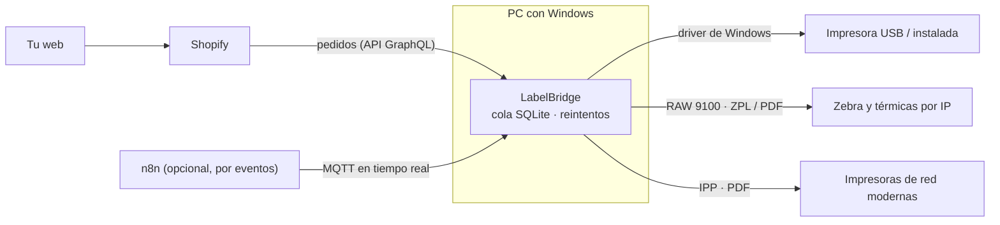
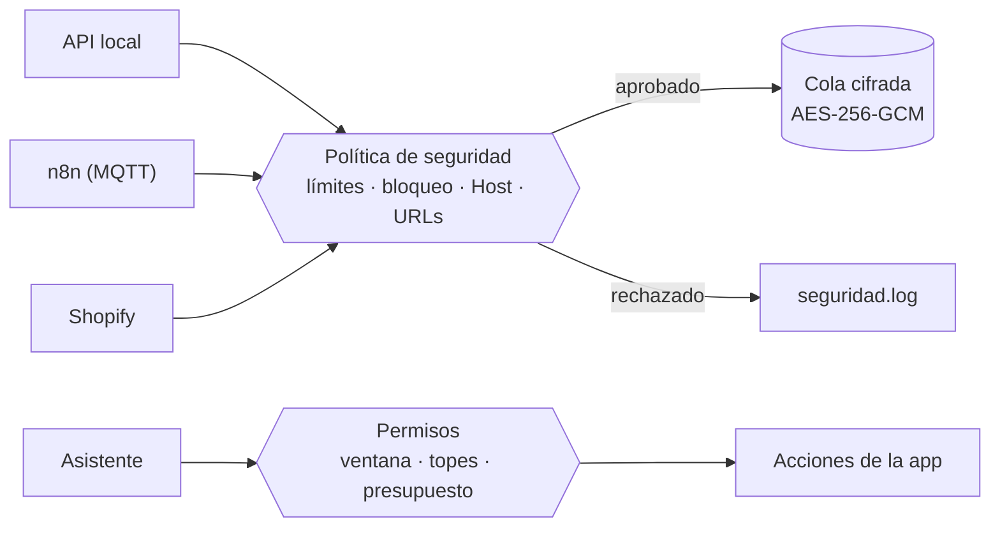

# LabelBridge

App de escritorio para **Windows** que imprime automáticamente las etiquetas de tus pedidos de **Shopify**. Se instala una vez, arranca con Windows, vive en la bandeja del sistema e imprime en segundo plano en cualquier impresora: instalada en Windows o conectada por **Wi‑Fi / red local** (sin driver).



## Qué hace

- **Asistente con IA**: escribes tus datos con tus palabras («tengo una Zebra por USB y mi tienda es mi-tienda.myshopify.com») y el asistente (Claude Opus 5.5 de Anthropic) configura la app con las mismas acciones de las pantallas: agrega la impresora, conecta la tienda, prueba la conexión y activa la impresión de las guías. Los secretos se piden en una ventana segura y nunca se envían al modelo; comprar guías siempre pide confirmación.
- **Guía paso a paso integrada**: al instalar, la app abre una guía que lleva de la mano por toda la configuración (impresora, prueba, remitente, app de Shopify, pedido de prueba) y marca cada paso solo cuando comprueba que quedó listo.
- **Impresoras**: lista las instaladas en Windows y **busca en la red** (puertos 9100/631/515 y Bonjour) automáticamente cada vez que el PC se conecta a una red Wi‑Fi/LAN, avisando si aparece una impresora nueva. Imprime por driver, por **IP directa sin driver** (RAW 9100 o IPP) y puede **instalar en Windows** una impresora de red encontrada.
- **Formatos**: PDF, PNG/JPG, **ZPL**, RAW (EPL/TSPL/ESC‑POS). Convierte PDF a ZPL para cualquier Zebra, **rota** etiquetas apaisadas y **recorta** una 4×6 dentro de una hoja carta/A4.
- **Shopify directo** (sin n8n):
  - **guía de envío de Shopify Shipping** (la etiqueta principal): la compra por API (`shippingLabelPurchase`, nueva en 2026‑07) para cada pedido pagado y la imprime en PDF/ZPL, con límite diario y sin compras duplicadas;
  - etiqueta interna de pedido opcional (dirección, productos, código de barras Code 128 y QR al pedido, sin franqueo);
  - impresión de la URL guardada en un **metafield** del pedido (etiquetas de cualquier paquetería creadas por n8n o tu web).
- **n8n por eventos**: n8n se ejecuta **solo cuando ocurre algo** (pedido pagado) y envía la etiqueta al PC al instante por un canal MQTT cifrado. Si el PC está apagado, la etiqueta espera y se imprime al encenderlo. 1 ejecución por pedido, sin consultas periódicas.
- **API local** HTTP con clave, para n8n en tu red, tu web, scripts o un ERP.
- **Cola persistente** (SQLite): nada se pierde si se va la luz; reintentos automáticos; historial con vista previa, reimpresión y cancelación.
- **Profesional por dentro**: secretos en el Administrador de credenciales de Windows, una sola instancia, inicio con Windows, notificaciones, registro en vivo, instalador con Inno Setup.

## Por qué Python + PySide6 (Qt)

- **Qt** da en un solo framework la interfaz nativa, la bandeja del sistema, la lista de impresoras, el render de PDF (PDFium) y la impresión por driver.
- Puedes **desarrollar y probar en tu Mac** (impresoras de prueba que guardan PDF/ZPL) y generar el `.exe` para Windows con GitHub Actions.
- El resultado es un `.exe` normal con instalador, sin que el usuario instale Python.

La alternativa sería C#/.NET (WPF): igual de válida en Windows, pero no podrías ejecutarla ni probarla en tu Mac.

## Empezar (desarrollo)

Requisitos: Python 3.11–3.13 (recomendado 3.12).

```bash
python3.12 -m venv .venv
```

```bash
.venv/bin/pip install -r requirements.txt -r requirements-dev.txt
```

```bash
.venv/bin/python run.py --show
```

En Windows usa `.venv\Scripts\python run.py --show`.

Primeros pasos dentro de la app:

1. **Impresoras → Agregar → Guardar como archivo (pruebas)** para probar sin gastar etiquetas (guarda PDF/ZPL en la carpeta «salida»).
2. Agrega tu impresora real: *Instaladas en este equipo* o *En la red → Buscar en la red*. Pulsa **Imprimir prueba**.
3. **Shopify**: sigue [docs/SHOPIFY.md](docs/SHOPIFY.md) para crear la app en el Dev Dashboard, pega Client ID y Client secret y **Guardar y probar conexión**.
4. Elige qué imprimir en cada pedido y la impresora de cada cosa.

Pruebas automáticas (no usan impresoras reales):

```bash
QT_QPA_PLATFORM=offscreen .venv/bin/python -m pytest -q
```

## Generar el instalador de Windows

**Opción A — GitHub Actions (no necesitas Windows):** sube el proyecto a un repositorio de GitHub y crea un tag `v1.0.0`, o ejecuta el workflow *Build Windows installer* a mano. Descarga `LabelBridge-Setup-1.0.0.exe` desde los *artifacts* de la ejecución.

**Opción B — En un PC con Windows:**

```powershell
powershell -ExecutionPolicy Bypass -File packaging\build_windows.ps1
```

Genera `dist\LabelBridge\LabelBridge.exe` y, si tienes [Inno Setup 6](https://jrsoftware.org/isdl.php), el instalador en `dist\installer\`.

El instalador no pide administrador (instalación por usuario), crea accesos directos, cierra la app si está abierta al actualizar y, opcionalmente, agrega la regla de firewall para la API local. El inicio automático con Windows se controla desde *Ajustes* (activado por defecto).

> Para distribuir a otras personas sin el aviso de SmartScreen, firma el `.exe` y el instalador con un certificado de firma de código.

## Pruebas reales del asistente

`devtools/assistant_eval.py` conversa de verdad con Claude (usa la clave guardada en el almacén seguro, nunca la imprime) en un entorno aislado con impresoras, tienda y ventanas simuladas: no imprime, no toca la tienda y no escanea la red. Mide si cada tarea quedó bien, las llamadas, los tokens y el costo. Gasta tokens: se ejecuta a mano.

```bash
.venv/bin/python devtools/assistant_eval.py --model claude-opus-5-5 --effort low
```

## Actualizaciones automáticas

- Página pública de descargas: <https://morghullis.github.io/labelbridge-updates/> (solo instalador y versión; el código sigue privado).
- La app consulta esa página al arrancar y cada 6 horas. Si hay una versión nueva muestra **«Nueva versión disponible»** con las novedades; al pulsar **Actualizar ahora** descarga el instalador, verifica su SHA-256, se cierra, se instala en silencio y se vuelve a abrir mostrando **«¡Actualización instalada!»**. La configuración y el historial se conservan.
- También: **Ajustes → Actualizaciones → Buscar actualizaciones ahora**, o clic derecho en el icono de la bandeja.

### Publicar una versión nueva

1. Sube `__version__` en `labelbridge/__init__.py` (p. ej. `1.2.0`).
2. Agrega en `CHANGELOG.md` una sección `## 1.2.0` con las novedades (líneas que empiezan por `- `).
3. Crea y sube el tag:

```bash
git tag -a v1.2.0 -m "LabelBridge 1.2.0" && git push origin main v1.2.0
```

GitHub Actions prueba todo, genera las capturas de la guía, compila y verifica el `.exe`, lo publica en Releases (privado) y en la página de descargas (público). Todas las apps instaladas lo detectan solas.

## ¿Cómo llegan los pedidos?

| Modo | Cómo | Ejecuciones de n8n |
|---|---|---|
| **Shopify directo** | La app lee los pedidos de Shopify (cada 15–30 s) y compra/imprime sola. | 0 (no usa n8n) |
| **n8n por eventos** (recomendado con n8n) | Pedido pagado → n8n → canal MQTT → el PC imprime al instante. Plantillas `01` y `02`. | 1 por pedido |
| **Metafield** | n8n guarda la URL de la guía en el pedido; la app la lee de Shopify. Plantilla `03`. | 1 por pedido |
| **Misma red** | n8n self-hosted o tu web: `POST http://IP-DEL-PC:7300/api/v1/jobs` | 1 por pedido |

Detalles en [n8n/README.md](n8n/README.md) y [docs/PROTOCOLO.md](docs/PROTOCOLO.md).

> **Importante:** la *etiqueta de pedido* que genera LabelBridge no lleva franqueo. Para la guía de la paquetería usa la compra con Shopify Shipping, o el metafield con la etiqueta de tu paquetería.

## Estructura

```
labelbridge/
  app.py               arranque (bandeja, ventana, servicios)
  config.py            configuración (JSON) y tamaños de etiqueta
  secret_store.py      secretos en el almacén seguro del sistema
  jobstore.py          cola e historial (SQLite)
  models.py            formato de los trabajos
  discovery.py         búsqueda de impresoras en la red
  printing/            motor: driver, RAW 9100, IPP, ZPL, PDF, código de barras
  labels/              etiqueta de pedido (Qt y ZPL nativo)
  connectors/          API local, n8n y Shopify
  assistant/           asistente: herramientas, permisos, consumo, conversación con Claude y filtro de secretos
  security/            cifrado, política de seguridad, límites, auditoría y registros sin secretos
devtools/              pruebas reales del asistente (gastan tokens)
  system/              inicio con Windows, instancia única, instalar impresoras
  ui/                  interfaz (PySide6)
n8n/                   plantillas de flujos + guía
docs/                  Shopify y protocolo
packaging/             PyInstaller, Inno Setup, script de compilación
tests/                 pruebas automáticas
```

Los datos de la app (configuración, cola, registros) se guardan en `%LOCALAPPDATA%\LabelBridge` en Windows y en `~/Library/Application Support/LabelBridge` en macOS.

## Seguridad



- **Una sola puerta** (`labelbridge/security/policy.py`): todo trabajo que llega por la API local, n8n o Shopify pasa por la política de seguridad antes de entrar en la cola (límite por minuto, copias máximas, URL permitida). Las descargas y **cada redirección** se revisan contra SSRF: nada de direcciones reservadas y, según el ajuste, nada de la red interna.
- **Cifrado en disco**: la configuración (`config.enc`), los pedidos, las etiquetas y los campos sensibles de la cola (URL, cabeceras, datos del pedido) van cifrados con AES-256-GCM ligado a cada registro. La clave de datos es aleatoria y vive en el Administrador de credenciales de Windows; sin ella los archivos no se pueden leer ni copiándolos a otro equipo. Lo que guardaron versiones anteriores se cifra solo al actualizar.
- **API local**: límite de peticiones por minuto y equipo, bloqueo temporal tras claves incorrectas (con aviso), máximo de conexiones simultáneas, tiempo de espera por conexión, cabecera `Host` verificada contra DNS rebinding y errores sin detalles internos.
- **Registros sin secretos**: claves, tokens, firmas de URLs y correos se borran antes de escribir cualquier registro. Lo aprobado y lo rechazado queda en `logs/seguridad.log`.
- **Asistente**: solo hace tareas de LabelBridge; cada cambio pide permiso en una ventana (una vez o para la conversación), comprar guías y borrar tienen su propia confirmación, hay topes de uso por conversación, límite de mensajes por hora y de gasto por día, y no puede cambiar sus propios límites ni la seguridad.
- Client secret, tokens y claves en el **Administrador de credenciales de Windows** (Llavero en macOS), nunca en la configuración. Si el almacén no está disponible, el archivo de respaldo va protegido con DPAPI.
- Asistente: lo que parece una clave en el chat (`shpss_…`, `shpat_…`, `sk-ant-…` o lo que va tras «contraseña», «secret», «token»…) se guarda en este PC o se aparta antes de enviar el mensaje; el modelo solo ve una referencia. Activar la compra de guías, reprocesar pedidos con compra o eliminar una impresora siempre abre una ventana de confirmación fuera del chat.
- La API local escucha solo en `127.0.0.1` salvo que actives el acceso desde la red, y siempre exige clave (comparación en tiempo constante).
- IPPS: el certificado de la impresora se fija en el primer uso y se rechaza si cambia.
- Todas las conexiones salen del PC (HTTPS con Shopify, MQTT con TLS con el broker): no hay que abrir puertos.
