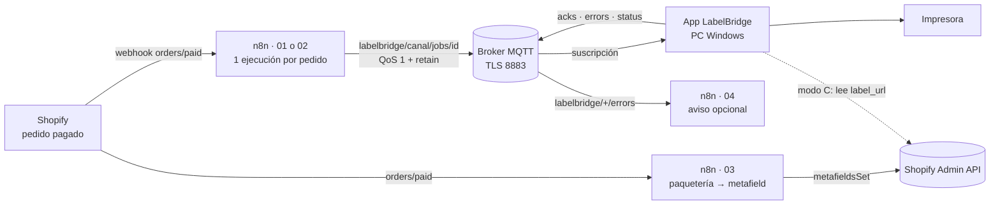
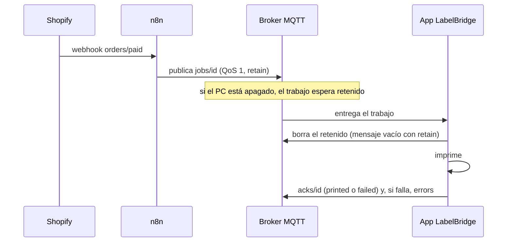

# LabelBridge · Workflows de n8n

Plantillas listas para importar en n8n (Cloud o self-hosted) que conectan **Shopify** con la app de escritorio **LabelBridge** (Windows).

**Solo eventos, sin sondeo**: n8n se ejecuta únicamente cuando ocurre algo (un pedido pagado, un error de impresión) y entrega el trabajo a la app **al instante** a través de un broker **MQTT**. La app solo abre conexiones salientes: no hay que abrir puertos en el PC.

## ¿Qué modo usar?

| Modo | Cómo funciona | Ejecuciones de n8n | Cuándo |
|---|---|---|---|
| **A · Sin n8n** | El **conector Shopify de la app** consulta Shopify, compra (Shopify Shipping) e imprime directo. | **0** | La opción más simple si no necesitas n8n. |
| **B · n8n + MQTT** *(recomendado con n8n)* | **01** o **02** publican el trabajo en el broker; la app, suscrita, imprime al momento. Si el PC está apagado, el trabajo queda **retenido** y se imprime al encenderlo. | **1 por pedido** | n8n Cloud o self-hosted. Necesita un broker MQTT. |
| **C · Metafield** | **03** guarda la URL de la etiqueta en el pedido; la app la lee de Shopify (*Etiqueta desde metafield*). | **1 por pedido** | n8n Cloud sin broker, con cualquier paquetería. |
| **D · HTTP directo (LAN)** | Nodo alternativo del **01**: `POST http://IP-DEL-PC:7300/api/v1/jobs` con `Authorization: Bearer <clave>`. | **1 por pedido** | n8n self-hosted en la misma red que el PC (si el PC está apagado, el envío falla). |

Usa **un solo camino por pedido**: 01, 02, 03 o el conector de la app. Si combinas varios, cada pedido se imprimirá (o se comprará) más de una vez.

## Contenido

| Archivo | Workflow | Qué hace |
|---|---|---|
| `01-pedido-a-labelbridge.json` | LabelBridge · Pedido pagado → imprimir al instante | Pedido pagado → trabajo `format: "order"` (la app dibuja la etiqueta) con solo los datos necesarios del pedido → MQTT. Incluye la alternativa LAN desactivada. |
| `02-comprar-etiqueta-shopify-shipping.json` | LabelBridge · Comprar etiqueta Shopify Shipping → imprimir | **Compra** la etiqueta con Shopify Shipping (Admin API `2026-10`) y publica el PDF/ZPL (etiqueta y aduana) por MQTT. **Genera cargos reales.** |
| `03-etiqueta-a-metafield.json` | LabelBridge · Etiqueta de cualquier paquetería → metafield del pedido | Crea la etiqueta en tu paquetería (nodo de ejemplo a editar) y guarda su URL en el metafield `custom.label_url`. Sin broker. |
| `04-avisar-errores.json` *(opcional)* | LabelBridge · Avisar de errores de impresión | Trigger MQTT en `labelbridge/+/errors` → aviso por email (desactivado, a configurar). Solo se ejecuta cuando una etiqueta falla. |

## Cómo funciona





## 1. Broker MQTT

> **HiveMQ Cloud Serverless (el plan gratuito) se ha retirado**: desde el 2026-09-30 no se pueden crear clusters nuevos y los existentes dejan de funcionar el 2026-12-31 (documentación de HiveMQ). Si ya tienes uno, planifica el cambio.

Sirve cualquier broker MQTT con **TLS**, **usuario y contraseña**, **mensajes retenidos** y **QoS 1**:

| Broker | Coste | Notas |
|---|---|---|
| **EMQX Platform · Serverless** | Cuota gratuita mensual: 1 000 000 minutos de sesión y 1 GB de tráfico | TLS en `8883`, mensajes de hasta 1 MB. Un cliente conectado todo el mes ≈ 43 200 minutos. |
| **HiveMQ Cloud · Starter** | Prueba de 15 días sin tarjeta; después, de pago | TLS en `8883`. |
| **Mosquitto u otro propio** | Gratis (lo mantienes tú) | Con n8n Cloud debe ser accesible desde Internet con TLS. |

Crea **dos usuarios**: `n8n` (publica trabajos y escucha errores) y `labelbridge-pc` (el de la app). Así puedes cambiar la contraseña de uno sin tocar el otro.

**EMQX Serverless**
1. Consola de EMQX Cloud → **New Deployment** → plan **Serverless**. Define el **Spend Limit** (con 0 solo usas la cuota gratuita), el nombre y pulsa **Deploy**.
2. **Access Control → Authentication → Add**: crea `n8n` y `labelbridge-pc` con contraseñas largas.
3. En **Overview** copia la dirección del broker (el host). Puerto **8883** (MQTT sobre TLS).

**HiveMQ Cloud (Starter)**
1. Crea el cluster en la consola de HiveMQ Cloud.
2. **Access Management → Credentials → Edit → Add Credentials**: `n8n` y `labelbridge-pc`, cada uno con un rol que permita publicar y suscribirse.
3. Copia la *TLS MQTT URL* del cluster (host `….hivemq.cloud`). Puerto **8883**.

## 2. Credenciales en n8n

**MQTT** (Credentials → Create credential → **MQTT**), nombre `LabelBridge MQTT`:

| Campo | Valor |
|---|---|
| Protocol | **Mqtts** |
| Host | El host del broker, sin `mqtts://` ni puerto |
| Port | **8883** |
| Username / Password | Usuario `n8n` del broker |
| Client ID | **Vacío** (n8n genera uno; dos conexiones con el mismo ID se expulsan entre sí) |
| SSL | Desactivado: con *Mqtts* la conexión ya va cifrada y los brokers gestionados no necesitan certificados propios |

**Shopify** (01, 02 y 03): credencial **Shopify Access Token API** (`Shopify Access Token`) con *Shop Subdomain* (`mi-tienda`), *Access Token* (`shpat_…`) y *APP Secret Key* (n8n la usa para verificar la firma de los webhooks).

| Workflow | Scopes de la app de Shopify |
|---|---|
| 01 | `read_orders` + acceso a **datos protegidos de clientes** (nombre y dirección) |
| 02 | `read_orders`, `write_orders`, `write_merchant_managed_fulfillment_orders` + Términos de Shopify Shipping aceptados |
| 03 | `read_orders`, `write_orders` |

Shopify ya no permite crear apps personalizadas desde el admin (las existentes siguen funcionando). Si creas la app en el **Dev Dashboard**, usa la credencial **Shopify OAuth2 API** (registra en la app la *OAuth Redirect URL* que muestra n8n), cambia el trigger a *Authentication → OAuth2* y, en los nodos HTTP de Shopify, la credencial predefinida a *Shopify OAuth2 API*. No uses tokens del *client credentials grant*: caducan a las 24 h.

**Opcionales**: SMTP para el aviso del 04; *Header Auth* (`Authorization` = `Bearer <clave>`) para la alternativa LAN del 01; la credencial de tu paquetería en el 03.

## 3. Importar y activar

1. En n8n: **Create workflow** → menú **⋯** → **Import from File…** (o pega el JSON en el lienzo con Ctrl/Cmd + V).
2. Abre los nodos con aviso de credencial y elige la tuya (las plantillas traen ids de ejemplo).
3. Edita el nodo **Configuración**: `canal` y `printer` (01 y 02), `shop` (02 y 03).
4. Activa el workflow (interruptor **Active** o botón **Publish**, según tu versión). Al activar el 01, 02 o 03, n8n registra el webhook `orders/paid` en Shopify; el 04 se conecta al broker.

## 4. Configurar la app LabelBridge

En la pantalla **n8n** de la app:

| Campo | Valor |
|---|---|
| Host | El mismo host del broker |
| Puerto | `8883` |
| TLS | Activado |
| Usuario / Contraseña | `labelbridge-pc` |
| Canal | Igual que `canal` en los workflows, p. ej. `pc-bodega` (solo `a-z`, `0-9`, `-`) |

Cada PC usa su propio canal. Para enviar a otro PC, duplica el workflow y cambia `canal`.

## 5. Temas y mensajes

| Tema | Publica | QoS · retain | Contenido |
|---|---|---|---|
| `labelbridge/<canal>/jobs/<jobId>` | n8n | 1 · **retain** | Un trabajo. La app borra el retenido al guardarlo. |
| `labelbridge/<canal>/jobs` | n8n u otros | 1 · sin retain | Un trabajo o `{"jobs":[...]}` |
| `labelbridge/<canal>/acks/<jobId>` | App | 1 | Resultado `printed` / `failed` |
| `labelbridge/<canal>/errors` | App | 1 | Solo los fallos |
| `labelbridge/<canal>/status` | App (last will) | retain | `{"online":true\|false,…}` |

`<jobId>` = `id` del trabajo con todo lo que no sea `A-Z a-z 0-9 _ -` cambiado por `-`.

Trabajo del **01** (pedido minimizado):

```json
{
  "id": "pedido-5612345678901",
  "title": "Pedido #1001",
  "printer": "etiquetas",
  "copies": 1,
  "format": "order",
  "order": {
    "id": 5612345678901, "name": "#1001", "order_number": 1001, "created_at": "2026-10-03T10:00:00Z",
    "shipping_address": { "name": "Ana Pérez", "address1": "C/ Mayor 1", "city": "Madrid", "zip": "28001", "country_code": "ES" },
    "shipping_lines": [{ "title": "Envío estándar" }],
    "line_items": [{ "quantity": 2, "name": "Camiseta - M", "title": "Camiseta", "variant_title": "M", "sku": "CAM-M" }],
    "note": null, "total_price": "24.95", "currency": "EUR"
  },
  "meta": { "order_id": "5612345678901", "order_name": "#1001" }
}
```

Trabajo del **02** (uno por documento):

```json
{"id":"shopify-5612345678901-label-1","title":"Pedido #1001 · Etiqueta","printer":"etiquetas","copies":1,"format":"pdf","url":"https://…/label.pdf","meta":{"order_id":"5612345678901","document_type":"LABEL","tracking_number":"1Z…","carrier":"UPS"}}
```

Ack y estado (los publica la app):

```json
{"id":"pedido-5612345678901","status":"failed","error":"Impresora sin papel","agent":"PC-BODEGA","printer":"Zebra ZD421","at":"2026-10-03T12:00:05Z"}
{"online":true,"agent":"PC-BODEGA","version":"1.0.0","at":"2026-10-03T12:00:00Z"}
```

## 6. Probar

Con la app conectada (canal `pc-bodega`), publica un trabajo ZPL retenido. Puedes usar un cliente gráfico como **MQTTX**, el *Web Client* de la consola de HiveMQ Cloud o `mosquitto_pub`:

```bash
H="tu-host-del-broker"; U="n8n"; P="tu-contraseña"
TLS="--cafile /etc/ssl/cert.pem"   # macOS · en Linux: --capath /etc/ssl/certs

# Ver todo lo que pasa en el canal (trabajos, acks, errores, estado)
mosquitto_sub -h "$H" -p 8883 $TLS -u "$U" -P "$P" -t 'labelbridge/pc-bodega/#' -v

# Enviar un trabajo de prueba: QoS 1 y retenido, como hace n8n
mosquitto_pub -h "$H" -p 8883 $TLS -u "$U" -P "$P" -q 1 -r \
  -t 'labelbridge/pc-bodega/jobs/prueba-001' \
  -m '{"id":"prueba-001","title":"Prueba ZPL","printer":"etiquetas","copies":1,"format":"zpl","content":"^XA^FO50,50^A0N,40,40^FDHola LabelBridge^FS^XZ"}'

# Borrar a mano un retenido (la app lo hace sola tras guardar el trabajo)
mosquitto_pub -h "$H" -p 8883 $TLS -u "$U" -P "$P" -r -n -t 'labelbridge/pc-bodega/jobs/prueba-001'
```

Deberías ver la etiqueta impresa y un mensaje en `labelbridge/pc-bodega/acks/prueba-001`. Prueba también con la app cerrada: al abrirla, imprime el trabajo retenido.

## 7. Workflow 02: compra real de etiquetas

- Requisitos: Admin API 2026-07 o superior, los scopes de la tabla, **Términos de Shopify Shipping** aceptados y **datos protegidos de clientes**. **FedEx no está soportado.** Prueba primero en una **tienda de desarrollo**.
- **No actives también «Comprar etiqueta» en la app**: cada pedido se compraría dos veces.
- Flujo en **una sola ejecución**: fulfillment order `OPEN` → *Saltar si este pedido ya se compró* (Remove Duplicates, recuerda el id del pedido justo antes de comprar) → `shippingLabelPurchase` → consulta cada 5 s (máx. 12) → publica un trabajo por documento (`LABEL` y luego `CUSTOMS_FORM`).
- Si la compra falla o no termina en ~1 min, la ejecución se detiene con el motivo. Ese pedido **no se reintenta solo**: revisa Shopify y, si hace falta, compra la etiqueta desde allí.

## 8. Workflow 03: cualquier paquetería → metafield

1. **Configuración**: `shop`; `metafield_namespace` / `metafield_key` iguales que en la app (`custom` / `label_url`).
2. Edita y **activa** el nodo **Crear etiqueta en tu paquetería (EDITAR)**. Debe devolver la URL del PDF/ZPL, p. ej. `{"label_url":"https://…"}`; si viene en otro campo, añádelo a `CAMPOS` en **Extraer URL de la etiqueta**.
3. La definición del metafield (tipo **URL**) es opcional; si ya existe, debe ser de tipo URL.
4. En la app: conector Shopify con **Etiqueta desde metafield** (namespace `custom`, key `label_url`).

## 9. Solución de problemas

| Síntoma | Causa probable / solución |
|---|---|
| n8n: *Not authorized* / *Bad username or password* | Usuario o contraseña del broker; en HiveMQ, que el rol permita publicar y suscribirse. |
| n8n: *timeout*, *ECONNREFUSED*, *ENOTFOUND* | Host sin `mqtts://`, puerto `8883` y Protocol **Mqtts**. |
| Error de certificado | Desactiva **SSL** en la credencial de n8n o deja vacíos sus certificados: con *Mqtts* no hacen falta. |
| Conexiones que se cortan entre sí | Dos clientes con el mismo **Client ID**: déjalo vacío en n8n y usa un usuario distinto en la app. |
| La app no recibe nada | `canal` distinto en n8n y en la app. Mira el tema en la ejecución de n8n y escucha `labelbridge/#` con `mosquitto_sub`. |
| Un trabajo antiguo reaparece | Retenido sin borrar: la app lo borra al guardarlo; bórralo a mano con `-r -n`. La app ignora ids repetidos. |
| Un pedido se imprime o se compra dos veces | Hay dos caminos activos (p. ej. 01 y 02, o 02 y «Comprar etiqueta» en la app). |
| El broker rechaza el mensaje | Supera el tamaño máximo (1 MB en EMQX Serverless): usa `url` en vez de `content_base64`. |
| No llegan pedidos de Shopify | Workflow inactivo, *APP Secret Key* incorrecta, falta `read_orders` o el acceso a datos protegidos. Revisa *Executions*. |
| La etiqueta `order` sale sin dirección | Falta el acceso a datos protegidos de clientes (nombre y dirección). |
| 02: *Shopify no aceptó la compra…* | Validación de Shopify: dirección, paquete o peso, aduanas, sin tarifas o FedEx. El mensaje incluye el código. |
| 02: el nodo HTTP no ofrece *Shopify Access Token API* | *Generic Credential Type → Header Auth* con Name `X-Shopify-Access-Token`. |
| 03: *No se encontró la URL de la etiqueta…* | El nodo de la paquetería sigue desactivado o la URL viene en otro campo (`CAMPOS`). |
| 03: *Shopify no guardó la etiqueta…* | Falta `write_orders` o la definición `custom.label_url` existe con otro tipo. |
| 04 no avisa | Workflow activo, nodo de email activado y con SMTP, y el usuario `n8n` con permiso para suscribirse. |

## 10. Seguridad

- Solo TLS (puerto 8883) y una contraseña distinta para n8n y para cada PC.
- El 01 envía solo los datos del pedido necesarios para la etiqueta; no publiques pedidos completos.
- Los mensajes retenidos se guardan en el broker hasta que la app los borra: usa un broker de confianza.
