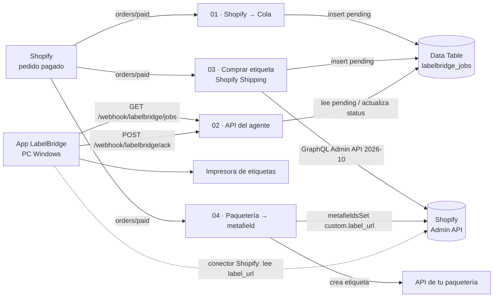
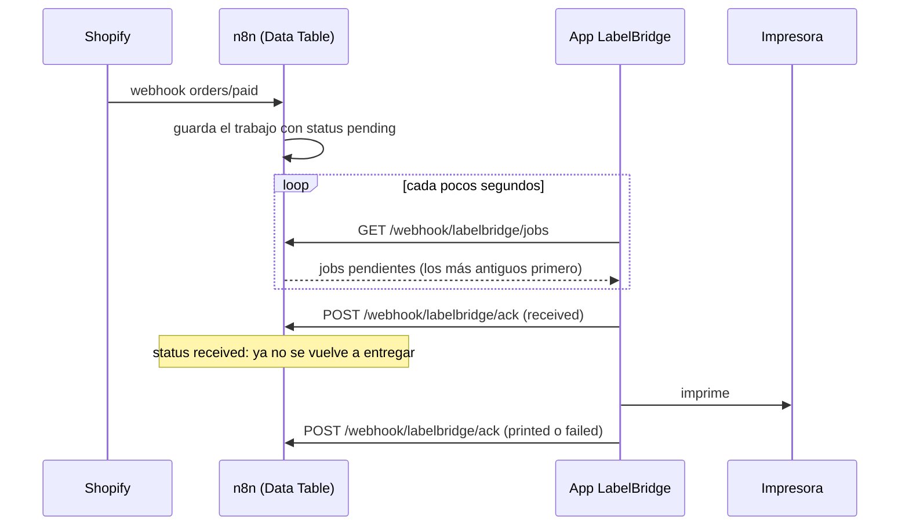

# LabelBridge · Workflows de n8n

Plantillas listas para importar en n8n (Cloud o self-hosted) que conectan **Shopify** con la app de escritorio **LabelBridge** (Windows).

La app solo hace peticiones **salientes** (a n8n o a Shopify): no hace falta abrir puertos ni exponer el PC.

## ¿Qué modo usar?

| Situación | Modo | Ejecuciones en n8n |
|---|---|---|
| **Recomendado: sin n8n** | El **conector Shopify de la app** compra la etiqueta (Shopify Shipping) e imprime directo. | Ninguna |
| **n8n Cloud**, cualquier paquetería | **04**: n8n crea la etiqueta y guarda su URL en el metafield `custom.label_url` del pedido; la app (conector Shopify con *Etiqueta desde metafield*) la lee de Shopify e imprime. | 1 por pedido · **0 de sondeo** |
| **n8n self-hosted** (sin límite de ejecuciones) | **01** u **03** + **02**: cola en Data Table que la app consulta. | 1 por pedido + 1 por consulta |
| **n8n en la misma red que el PC** | **01** con su nodo alternativo: envía el trabajo directo a la API local de la app (`http://IP-DEL-PC:7300/api/v1/jobs`, `Authorization: Bearer <API KEY>`). | 1 por pedido |

**El coste del sondeo (02)**: cada `GET …/labelbridge/jobs` de la app cuenta como **1 ejecución**, haya trabajos o no. Consultando cada 30 s son ≈ **86 400 ejecuciones/mes**; cada 60 s, ≈ **43 200/mes**. Por eso el 02 es para n8n **self-hosted** (sin límite de ejecuciones). En **n8n Cloud** usa el **04**.

## Contenido

| Archivo | Workflow | Qué hace |
|---|---|---|
| `01-shopify-pedidos-a-cola.json` | LabelBridge · Shopify → Cola de impresión | Por cada pedido **pagado** crea un trabajo `format: "order"` (la app dibuja la etiqueta con la dirección) y lo guarda como `pending`. Incluye una alternativa **desactivada** para enviar el trabajo directo a la API local del PC (n8n self-hosted en la misma red). |
| `02-api-del-agente.json` | LabelBridge · API del agente (jobs + ack) | Los dos endpoints que usa la app: `GET …/webhook/labelbridge/jobs` (entrega pendientes) y `POST …/webhook/labelbridge/ack` (actualiza el estado). **Necesario en modo cola** (01/03). |
| `03-comprar-etiqueta-shopify-shipping.json` | LabelBridge · Comprar etiqueta Shopify Shipping → Cola | **Compra** la etiqueta del transportista con Shopify Shipping (Admin API `2026-10`) y encola el PDF/ZPL (etiqueta y, si hay, formulario de aduana). **Genera cargos reales.** |
| `04-etiqueta-a-metafield.json` | LabelBridge · Etiqueta de cualquier paquetería → metafield del pedido | Crea la etiqueta en tu paquetería (nodo de ejemplo que debes editar) y guarda su URL en el metafield `custom.label_url` del pedido. La app la lee de Shopify: **sin sondeo en n8n**. |

Activa **un solo camino** por pedido: **04**, o **02** + (**01** o **03**). Si combinas varios, cada pedido imprimirá más de una etiqueta.

## Cómo encaja todo



Ciclo de vida de un trabajo en modo cola (01/03 + 02):



## 1. Crear la Data Table `labelbridge_jobs`

Solo para el modo cola (01/03 + 02); el 04 no la usa. En n8n: **Overview → Data tables → Create data table** (o *Create → Data table*), en el mismo proyecto donde importarás los workflows.

- Nombre **exacto**: `labelbridge_jobs` (los workflows la buscan por nombre).
- Crea estas columnas, todas de tipo **String**. `id`, `createdAt` y `updatedAt` las crea n8n solo: no las añadas.

| Columna | Contenido |
|---|---|
| `job_id` | Id del trabajo: `shopify-<id>-order`, `shopify-<id>-label-1`… (clave del ack) |
| `status` | `pending` → `received` → `printed` / `failed` |
| `title` | Texto para el historial de la app (`Pedido #1001`) |
| `printer` | Impresora pedida (alias); tras el ack, la que reporta la app |
| `order_id` | Id numérico del pedido de Shopify |
| `payload` | El trabajo completo en JSON (`JSON.stringify(job)`); es lo que recibe la app |
| `error` | Mensaje de error de un ack `failed` |
| `agent` | PC que confirmó el trabajo (p. ej. `PC-BODEGA`) |

## 2. Crear las credenciales

### 2.1 Clave del agente (modo cola, 02)

**Credentials → Create credential → Header Auth**

| Campo | Valor |
|---|---|
| Nombre de la credencial | `LabelBridge Agent Key` |
| Name | `X-Agent-Key` |
| Value | Una clave larga y aleatoria (la **misma** que pondrás en la app) |

Para generar la clave:

```bash
# macOS / Linux
openssl rand -hex 32
```

```powershell
# Windows PowerShell
$b = New-Object byte[] 32; [Security.Cryptography.RandomNumberGenerator]::Create().GetBytes($b); -join ($b | ForEach-Object { $_.ToString('x2') })
```

### 2.2 Shopify

Los workflows 01, 03 y 04 usan la credencial **Shopify Access Token API** (nombre sugerido `Shopify Access Token`):

| Campo | Valor |
|---|---|
| Shop Subdomain | `mi-tienda` (sin `.myshopify.com`) |
| Access Token | Admin API access token (`shpat_…`) |
| APP Secret Key | API secret key de la app; n8n la usa para verificar la firma (HMAC) de los webhooks |

- **Scopes de la app**: 01 → `read_orders`. 03 → `read_orders`, `write_orders`, `write_merchant_managed_fulfillment_orders`. 04 → `read_orders`, `write_orders` (escribir metafields de un pedido requiere el scope de escritura de pedidos).
- **Datos protegidos de clientes**: solicita acceso a nombre y dirección en la configuración de la app. Sin él, Shopify entrega los pedidos sin dirección (y puede impedir la suscripción a webhooks de pedidos).
- **Apps nuevas**: Shopify ya no permite crear apps personalizadas desde el admin (las existentes siguen funcionando). Si creas la app en el **Dev Dashboard**, usa la credencial **Shopify OAuth2 API** de n8n (registra en la app la *OAuth Redirect URL* que muestra n8n) y cambia en el trigger *Authentication → OAuth2* y, en los nodos HTTP de Shopify del 03 y el 04, la credencial predefinida a *Shopify OAuth2 API*. No pegues en *Access Token* un token del *client credentials grant*: caduca a las 24 h.

### 2.3 API local del PC (opcional, solo nodo alternativo del 01)

**Header Auth** con Name `Authorization` y Value `Bearer <API KEY de la app>`.

## 3. Importar los workflows

Importa solo lo que vayas a usar (ver *¿Qué modo usar?*); en modo cola, primero el **02**:

1. En n8n crea un workflow vacío (**Create workflow**), abre el menú **⋯** (arriba a la derecha) → **Import from File…** y elige el `.json`. También puedes pegar el contenido del archivo en el lienzo con Ctrl/Cmd + V.
2. Abre cada nodo marcado con aviso de credencial y selecciona la que creaste (las plantillas traen un id de ejemplo que no existe en tu instancia):
   - 02: los **dos** webhooks → `LabelBridge Agent Key`.
   - 01, 03 y 04: trigger de Shopify y los nodos HTTP que llaman a Shopify → credencial de Shopify.
3. En el 03 y el 04 edita el nodo **Configuración**: `shop` = subdominio de tu tienda (en el 03, además, `printer` = alias de la impresora en la app).
4. En el 04 edita y **activa** el nodo **Crear etiqueta en tu paquetería (EDITAR)** (ver sección 8).
5. Guarda.

## 4. Activar

Activa cada workflow con el interruptor **Active** (en versiones nuevas: botón **Publish**).

- Las URLs **de producción** (`/webhook/...`) solo responden con el workflow activo.
- Las URLs de prueba (`/webhook-test/...`) solo funcionan mientras pulsas *Listen for test event* en el editor.
- Al activar el 01, el 03 o el 04, n8n registra el webhook `orders/paid` en Shopify.

## 5. Configurar la app LabelBridge

**Con el 04** no hay URLs de n8n que configurar: en el conector Shopify de la app activa **Etiqueta desde metafield** con namespace `custom` y key `label_url`.

**En modo cola (02)**, en la conexión con n8n de la app pega las **Production URL** de los webhooks del 02 (ábrelos → pestaña *Production URL*):

| Dato | Valor |
|---|---|
| URL de trabajos | `https://TU-INSTANCIA.app.n8n.cloud/webhook/labelbridge/jobs` |
| URL de ack | `https://TU-INSTANCIA.app.n8n.cloud/webhook/labelbridge/ack` |
| Agent Key | El *Value* de la credencial `LabelBridge Agent Key` |
| Id de agente | Nombre del PC, p. ej. `PC-BODEGA` |

En n8n self-hosted, sustituye el dominio por el de tu instancia.

## 6. Probar el modo cola (02)

**Fila de prueba**: abre la Data Table y añade una fila con `job_id` = `prueba-001`, `status` = `pending`, `title` = `Prueba ZPL`, `printer` = `etiquetas` y este `payload`:

```json
{"id":"prueba-001","title":"Prueba ZPL","printer":"etiquetas","copies":1,"format":"zpl","content":"^XA^FO50,50^A0N,40,40^FDHola LabelBridge^FS^XZ"}
```

**curl** (macOS / Linux / Git Bash):

```bash
N8N="https://TU-INSTANCIA.app.n8n.cloud"
KEY="tu-clave-larga"

# Trabajos pendientes → {"jobs":[...]}  (o {"jobs":[]} si no hay)
curl -s "$N8N/webhook/labelbridge/jobs?agent=PC-BODEGA&limit=10" -H "X-Agent-Key: $KEY"

# Confirmar → {"ok":true}
curl -s -X POST "$N8N/webhook/labelbridge/ack" \
  -H "X-Agent-Key: $KEY" -H "Content-Type: application/json" \
  -d '{"id":"prueba-001","status":"printed","error":null,"agent":"PC-BODEGA","printer":"etiquetas","at":"2026-10-03T12:00:00Z"}'

# Sin clave → 403 "Authorization data is wrong!"
curl -s -i "$N8N/webhook/labelbridge/jobs"
```

**PowerShell** (en Windows PowerShell 5.1, `curl` es un alias de `Invoke-WebRequest`; usa `curl.exe` o estos comandos):

```powershell
$N8N = "https://TU-INSTANCIA.app.n8n.cloud"
$H = @{ "X-Agent-Key" = "tu-clave-larga" }
Invoke-RestMethod "$N8N/webhook/labelbridge/jobs?agent=PC-BODEGA&limit=10" -Headers $H
Invoke-RestMethod "$N8N/webhook/labelbridge/ack" -Method Post -Headers $H -ContentType "application/json" `
  -Body '{"id":"prueba-001","status":"printed","error":null,"agent":"PC-BODEGA","printer":"etiquetas","at":"2026-10-03T12:00:00Z"}'
```

Después del ack, la fila `prueba-001` debe tener `status = printed` y ya no aparece en `GET jobs`.

## 7. Workflow 03: compra real de etiquetas

Antes de activarlo:

- Admin API **2026-07 o superior** (la plantilla usa `2026-10`).
- Scopes `read_orders`, `write_orders`, `write_merchant_managed_fulfillment_orders`, **Términos de Shopify Shipping aceptados** y acceso a **datos protegidos de clientes**.
- **FedEx no está soportado** por la API de compra.
- **Prueba primero en una tienda de desarrollo.** Ejecutarlo a mano con un pedido real también compra.

Qué hace: elige la primera *fulfillment order* `OPEN` que necesite envío → `shippingLabelPurchase` → consulta el resultado cada 5 s (máx. 12 veces, ~1 min) → con `PURCHASED` crea un trabajo por documento (`LABEL` primero, luego `CUSTOMS_FORM`), `format` `pdf` o `zpl`, id `shopify-<id>-label-<n>`.

- Sin fulfillment order abierta (ya preparado, recogida en tienda…) → termina **sin comprar**.
- `userErrors`, `PURCHASE_FAILED` o sin respuesta tras ~1 min → la ejecución **falla con el motivo**. Revisa el pedido en Shopify **antes de reintentar** para no comprar dos veces.
- Si la fila `shopify-<id>-label-1` ya existe, no vuelve a comprar.

## 8. Workflow 04: cualquier paquetería → metafield

1. **Configuración**: `shop`; `metafield_namespace` / `metafield_key` iguales que en la app (`custom` / `label_url`).
2. **Crear etiqueta en tu paquetería (EDITAR)** viene **desactivado**: pon la URL, la autenticación y el cuerpo de la API de tu paquetería (el ejemplo ya mapea la dirección del pedido). Debe devolver la URL del PDF/ZPL, p. ej. `{"label_url":"https://…/etiqueta.pdf"}`. Después **actívalo**. Si la URL llega en otro campo, añádelo a `CAMPOS` en **Extraer URL de la etiqueta**.
3. Scopes `read_orders` y `write_orders`. La definición del metafield (*Configuración → Datos personalizados → Pedidos*, tipo **URL**) es opcional; si ya existe, debe ser de tipo URL.
4. En la app: conector Shopify con **Etiqueta desde metafield** (namespace `custom`, key `label_url`).

Si el pedido ya tiene `label_url` (webhook reenviado), no se crea otra etiqueta. Puedes ver el valor en el pedido, en el admin de Shopify (sección *Metafields*).

## 9. Solución de problemas

| Síntoma | Causa probable / solución |
|---|---|
| `404 … webhook "GET labelbridge/jobs" is not registered` | El 02 no está activo, usas `/webhook-test/` sin *Listen for test event*, o la ruta está mal escrita. |
| `403 Authorization data is wrong!` | Falta la cabecera `X-Agent-Key` o no coincide. La credencial debe tener Name exactamente `X-Agent-Key`. |
| `500 No authentication data defined on node!` | No seleccionaste la credencial en uno de los webhooks tras importar. |
| Siempre `{"jobs":[]}` | No hay filas con `status` exactamente `pending`, o la tabla no se llama `labelbridge_jobs`. |
| Error *data table not found* | Crea la tabla con ese nombre en el **mismo proyecto** que el workflow, o elígela en los nodos *Data table*. |
| La app recibe el mismo trabajo una y otra vez | El ack `received` no llega: revisa URL de ack y clave; en la tabla el `status` debe cambiar. |
| `400` en el ack | Falta `id` o el `status` no es `received`, `printed` o `failed`; envía `Content-Type: application/json`. |
| No llegan pedidos de Shopify | Workflow 01/03 inactivo, credencial o *APP Secret Key* incorrectos, falta `read_orders` o el acceso a datos protegidos. Mira *Executions* del workflow. |
| La etiqueta `order` sale sin dirección | La app no tiene acceso a datos protegidos de clientes (nombre/dirección). |
| 03: *Shopify no aceptó la compra…* | Validación de Shopify: dirección, paquete/peso, aduanas, sin tarifas o FedEx. El mensaje trae el código. |
| 03: *no tiene fulfillment orders visibles* | Falta `write_merchant_managed_fulfillment_orders`, o el pedido se acaba de crear: reintenta la ejecución. |
| 03: el nodo HTTP no ofrece *Shopify Access Token API* | Usa *Generic Credential Type → Header Auth* con Name `X-Shopify-Access-Token` y el token como Value. |
| 03: la app no puede descargar el PDF/ZPL | Abre la URL del `payload` en un navegador; si exige autenticación, descarga el archivo en n8n y envíalo como `content_base64`. |
| No veo ejecuciones del 02 | Es intencionado: no guarda las ejecuciones correctas. Cámbialo en *Settings → Save successful production executions* mientras depuras. |
| 04: *No se encontró la URL de la etiqueta…* | El nodo de la paquetería sigue desactivado, o tu API devuelve la URL en otro campo (añádelo a `CAMPOS`). |
| 04: *Shopify no guardó la etiqueta…* | Falta `write_orders`, o ya existe una definición `custom.label_url` de un tipo distinto de URL. |
| 04: la app no imprime | Comprueba que el pedido tiene el metafield y que la app tiene *Etiqueta desde metafield* activado con el mismo namespace y key. |

## 10. Límites y buenas prácticas

- **Ejecuciones (n8n Cloud)**: con el 02, cada consulta de la app es una ejecución (cifras en *¿Qué modo usar?*). Revisa el límite de tu plan; en n8n Cloud usa el 04.
- **Tamaño de la tabla**: n8n limita el espacio total de las Data Tables (por defecto unos 50 MB) y cada trabajo `order` guarda el pedido completo. Borra de vez en cuando las filas `printed` antiguas.
- **Varios PCs**: todos los agentes ven los mismos pendientes; el primero que confirma `received` se queda el trabajo. Si dos consultan a la vez pueden recibir el mismo; la app de cada PC solo evita duplicados en ese PC.
- **Seguridad**: trata la Agent Key como una contraseña. Para rotarla, cambia el *Value* de la credencial y la clave en la app.
